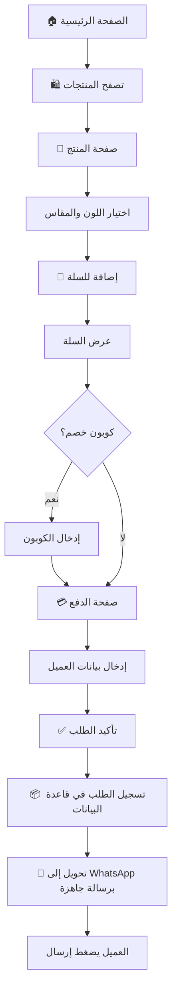

# 📋 وثيقة متطلبات المنتج (PRD) — متجر إلكتروني للملابس

> **الحالة:** مسودة أولى  
> **التاريخ:** 2026-11-08  
> **النسخة:** 0.1

---

## 1. نظرة عامة

متجر إلكتروني احترافي لعلامة تجارية تونسية جديدة متخصصة في بيع الملابس.
يستهدف المتجر السوق التونسي (18 سنة فما فوق) ويعمل بنموذج **بائع واحد (Single Vendor)**
حيث يقوم صاحب البراند بعرض وبيع منتجاته الخاصة مباشرة.

**إتمام الطلب يتم عبر WhatsApp**: بعد تأكيد الطلب يُحوَّل العميل إلى محادثة WhatsApp
تحتوي على جميع تفاصيل الطلب جاهزة للإرسال.

| البند              | التفاصيل                             |
| ------------------ | ------------------------------------ |
| نوع المنتجات       | ملابس (منتجات مادية)                 |
| نموذج العمل        | بائع واحد (صاحب البراند)             |
| السوق المستهدف     | تونس — 18 سنة فما فوق               |
| اللغات             | العربية · الفرنسية · الإنجليزية      |
| العملة             | الدينار التونسي (TND)                |
| الإلهام التصميمي   | موقع Nike — تصميم مينيمالست عصري     |

---

## 2. الأهداف

1. بناء حضور رقمي احترافي لعلامة تجارية جديدة في سوق الملابس التونسي.
2. تقديم تجربة تسوّق سلسة وجذابة بصرياً تنافس المتاجر العالمية.
3. تسهيل عملية الشراء عبر ربط مباشر بـ WhatsApp.
4. توفير لوحة تحكم بسيطة وفعّالة لإدارة المنتجات والطلبات.
5. بناء ولاء العملاء من خلال نظام نقاط المكافآت.

---

## 3. خريطة الصفحات (Sitemap)

```
🏠 الصفحة الرئيسية
├── 🛍️ المنتجات (كتالوج)
│   ├── فلتر حسب النوع (رجال / نساء / أطفال)
│   ├── فلتر حسب الفئة (تيشيرتات، بناطيل، جاكيتات، إكسسوارات…)
│   └── 📄 صفحة تفاصيل المنتج
├── 🔥 الأكثر مبيعاً
├── 🏷️ العروض الخاصة
├── 📝 المدوّنة (Blog)
├── 🛒 سلة المشتريات
├── 💳 صفحة الدفع (Checkout → WhatsApp)
├── 👤 حسابي
│   ├── تتبع الطلب
│   ├── تاريخ الطلبات
│   ├── قائمة المفضّلات (Wishlist)
│   └── البيانات الشخصية
├── ℹ️ من نحن
└── 📞 تواصل معنا
```

---

## 4. تفاصيل الصفحات

### 4.1 الصفحة الرئيسية

| العنصر                     | الوصف                                                              |
| -------------------------- | ------------------------------------------------------------------ |
| بانرات رئيسية (Hero)       | صور / فيديوهات كبيرة قابلة للتمرير يتحكم بها صاحب المتجر          |
| تصنيفات سريعة             | أزرار تنقل حسب النوع (رجال / نساء / أطفال)                        |
| منتجات مميزة              | عرض مجموعة مختارة من المنتجات                                      |
| الأكثر مبيعاً              | قسم يعرض المنتجات الأكثر طلباً                                     |
| العروض الخاصة              | منتجات عليها تخفيض                                                 |
| آخر منشورات Instagram      | عرض مباشر لآخر المنشورات من حساب البراند                           |
| أيقونات التواصل الاجتماعي  | Instagram · Facebook · TikTok (في الـ Footer)                      |

### 4.2 صفحة المنتجات (الكتالوج)

- **التصنيف الرئيسي:** حسب النوع (رجال / نساء / أطفال).
- **الفلاتر الإضافية:** حسب الفئة (تيشيرتات، بناطيل، جاكيتات، إكسسوارات…)، السعر، اللون، المقاس.
- **بطاقة المنتج:** صورة رئيسية + اسم + سعر (مع سعر قبل التخفيض إن وُجد).
- **الترتيب:** الأحدث، الأكثر مبيعاً، السعر (تصاعدي / تنازلي).

### 4.3 صفحة تفاصيل المنتج

> [!IMPORTANT]
> هذه الصفحة هي قلب تجربة التسوّق ويجب أن تكون غنية بصرياً ومقنعة.

| العنصر                     | الوصف                                                                                     |
| -------------------------- | ----------------------------------------------------------------------------------------- |
| معرض الصور                 | صور متعددة عالية الجودة مع إمكانية التكبير                                                |
| عرض ثلاثي الأبعاد (3D)     | عرض المنتج بشكل 3D تفاعلي (دوران 360°) إن أمكن تقنياً                                   |
| زر مشاهدة الفيديو          | يوجّه العميل إلى فيديو استعراضي على صفحة Instagram الخاصة بالبراند                        |
| اختيار اللون               | عند الضغط على لون تتغير صور المنتج بانتقال سلس واحترافي                                   |
| اختيار المقاس              | عرض المقاسات المتوفرة (XS, S, M, L, XL, XXL…) مع توضيح المتاح والنافد                    |
| دليل المقاسات (Size Guide) | جدول يوضح قياسات كل مقاس (الصدر، الطول، الخصر…) مع رسم توضيحي لطريقة القياس              |
| السعر                      | السعر الحالي + السعر قبل التخفيض (مشطوب) + نسبة الخصم                                     |
| الوصف التفصيلي             | نص وصفي للمنتج (الخامة، طريقة الغسيل، تفاصيل إضافية)                                     |
| تقييمات العملاء (Reviews)  | مفتوحة لأي مشتري — صاحب المتجر يستطيع حذف أي تعليق غير لائق                              |
| إشعار "عاد للمخزون"        | إذا نفد المقاس/اللون، يمكن للعميل تسجيل بريده ليُنبَّه عند التوفر                        |
| إضافة للمفضّلة             | زر إضافة المنتج لقائمة المفضّلات                                                          |
| زر "أضف إلى السلة"         | إضافة المنتج بالمقاس واللون المختارين إلى سلة المشتريات                                    |

### 4.4 سلة المشتريات

- قائمة المنتجات المختارة (صورة مصغّرة + اسم + لون + مقاس + كمية + سعر).
- إمكانية تعديل الكمية أو حذف منتج.
- حقل إدخال كوبون الخصم (Promo Code).
- ملخص: المجموع الفرعي + تكلفة التوصيل + الخصم (إن وُجد) + المجموع النهائي.
- زر "إتمام الطلب".

### 4.5 صفحة الدفع (Checkout)

- **الشراء بدون حساب (Guest Checkout):** متاح — لا يُشترط إنشاء حساب.
- بيانات العميل: الاسم الكامل، رقم الهاتف، العنوان (الولاية، المدينة، العنوان التفصيلي).
- ملخص الطلب النهائي.
- **تكلفة التوصيل:**
  - سعر ثابت لكل أنحاء تونس.
  - توصيل مجاني إذا تجاوز الطلب مبلغاً معيّناً (يُحدّد من لوحة التحكم).
- زر **"تأكيد الطلب"**:
  - يُسجَّل الطلب في قاعدة بيانات الموقع.
  - يُحوَّل العميل تلقائياً إلى WhatsApp برسالة جاهزة تحتوي على جميع تفاصيل الطلب.
  - ما على العميل سوى الضغط على "إرسال".

### 4.6 صفحة حسابي

| الميزة              | الوصف                                                    |
| ------------------- | -------------------------------------------------------- |
| تتبع الطلب          | عرض حالة الطلب الحالي (جديد → قيد التوصيل → تم التسليم) |
| تاريخ الطلبات       | جميع الطلبات السابقة مع تفاصيلها                         |
| قائمة المفضّلات     | المنتجات المحفوظة                                        |
| البيانات الشخصية    | تعديل الاسم، الهاتف، العنوان                             |
| نقاط الولاء         | رصيد النقاط الحالي وسجل الاستبدالات                      |

### 4.7 الصفحات الثابتة

- **من نحن:** قصة البراند ورؤيته (محتوى قابل للتعديل من لوحة التحكم).
- **تواصل معنا:** نموذج تواصل + معلومات الاتصال + روابط التواصل الاجتماعي.
- **المدوّنة (Blog):** مقالات عن الموضة، نصائح تنسيق، أخبار البراند.

---

## 5. نظام نقاط الولاء

> [!NOTE]
> هدف النظام هو تحفيز العملاء على تكرار الشراء وبناء ولاء طويل الأمد.

| البند                    | الوصف                                                         |
| ------------------------ | ------------------------------------------------------------- |
| كسب النقاط               | يحصل العميل على نقاط عند كل عملية شراء مكتملة بنجاح           |
| قيمة النقاط              | يحدّدها صاحب المتجر من لوحة التحكم (مثلاً: 1 دينار = 10 نقاط) |
| استبدال النقاط            | يستطيع العميل استبدال نقاطه بخصم على طلب قادم                  |
| الحد الأدنى للاستبدال     | يُحدَّد من لوحة التحكم                                        |
| عرض الرصيد               | يظهر رصيد النقاط في صفحة "حسابي"                              |

---

## 6. نظام الكوبونات (Promo Codes)

- إنشاء كوبونات بنسبة خصم (%) أو مبلغ ثابت.
- تحديد تاريخ انتهاء الصلاحية.
- تحديد عدد مرات الاستخدام الأقصى.
- تحديد حد أدنى لقيمة الطلب لتفعيل الكوبون.

---

## 7. إشعار "عاد للمخزون" (Back in Stock)

- عندما ينفد مقاس أو لون معيّن، يظهر للعميل حقل لإدخال بريده الإلكتروني.
- عند إعادة توفر المنتج، يُرسَل إشعار تلقائي بالبريد الإلكتروني للعملاء المسجّلين.

---

## 8. لوحة التحكم (Admin Dashboard)

> [!IMPORTANT]
> مستخدم واحد فقط حالياً: صاحب البراند بصلاحيات كاملة. يمكن توسيع نظام الصلاحيات مستقبلاً.

### 8.1 إدارة المنتجات

- إضافة / تعديل / حذف المنتجات.
- رفع صور متعددة لكل منتج.
- تحديد الألوان المتوفرة وربط كل لون بصوره الخاصة.
- تحديد المقاسات المتوفرة والكمية في المخزون لكل مقاس/لون.
- تحديد السعر الأصلي وسعر البيع (للتخفيضات).
- إضافة رابط فيديو Instagram.
- تصنيف المنتج (النوع + الفئة).
- إدارة دليل المقاسات.

### 8.2 إدارة الطلبات

- عرض جميع الطلبات مع بيانات العميل وتفاصيل المنتجات.
- تغيير حالة الطلب:
  - `جديد` → `قيد التوصيل` → `تم التسليم`
  - `ملغي`
- فلترة الطلبات حسب الحالة والتاريخ.

### 8.3 إدارة الكوبونات

- إنشاء / تعديل / حذف / تعطيل كوبونات الخصم.

### 8.4 إدارة التقييمات

- عرض جميع تقييمات العملاء.
- حذف التقييمات غير اللائقة.

### 8.5 إدارة المحتوى

- تعديل بانرات الصفحة الرئيسية.
- تعديل صفحة "من نحن".
- إدارة مقالات المدوّنة.

### 8.6 إعدادات المتجر

- تكلفة التوصيل الثابتة.
- الحد الأدنى للتوصيل المجاني.
- رقم WhatsApp.
- روابط حسابات التواصل الاجتماعي.
- إعدادات نظام نقاط الولاء (قيمة النقطة، الحد الأدنى للاستبدال).

### 8.7 الإحصائيات

- عدد الطلبات (يومي / أسبوعي / شهري).
- إجمالي الإيرادات.
- المنتجات الأكثر مبيعاً.
- عدد الزوار (إن أمكن).

---

## 9. الصلاحيات

| الدور             | الصلاحيات                                   |
| ----------------- | ------------------------------------------- |
| صاحب المتجر (Admin) | صلاحيات كاملة على كل أقسام لوحة التحكم       |
| العميل المسجّل     | حسابي، تتبع الطلبات، المفضّلة، التقييمات، نقاط الولاء |
| الزائر (Guest)     | تصفح المنتجات، إضافة للسلة، الشراء بدون حساب |

> [!TIP]
> يمكن مستقبلاً إضافة أدوار إضافية (مدير طلبات، مدير محتوى) إذا توسّع الفريق.

---

## 10. المتطلبات غير الوظيفية

| المتطلب              | الوصف                                                           |
| -------------------- | --------------------------------------------------------------- |
| التصميم              | مستوحى من Nike — مينيمالست، عصري، أنيق                          |
| العرض ثلاثي الأبعاد  | عرض 3D تفاعلي للمنتجات (دوران 360°) إن أمكن تقنياً              |
| التجاوب (Responsive) | تصميم متجاوب يعمل بسلاسة على الهاتف، التابلت، والحاسوب          |
| الأداء               | تحميل سريع للصفحات والصور                                       |
| SEO                  | تحسين محركات البحث (بنية URLs نظيفة، meta tags، sitemap)         |
| تعدد اللغات          | واجهة كاملة بالعربية والفرنسية والإنجليزية مع إمكانية التبديل    |
| اتجاه النص (RTL/LTR) | دعم كامل للعربية (RTL) والفرنسية/الإنجليزية (LTR)               |

---

## 11. تدفق الشراء (User Flow)



---

## 12. القيم الافتراضية والإعدادات المبدئية

| الإعداد                        | القيمة                                     | ملاحظة                        |
| ------------------------------ | ------------------------------------------ | ----------------------------- |
| اسم البراند                    | **VAYRO**                                  | مستخلص من حساب Instagram       |
| تكلفة التوصيل                  | **8 دينار تونسي** (ثابت لكل تونس)          | قابل للتعديل من لوحة التحكم   |
| الحد الأدنى للتوصيل المجاني    | **100 دينار تونسي**                        | قابل للتعديل من لوحة التحكم   |
| كسب نقاط الولاء                | **1 نقطة لكل 1 دينار** مصروف               | قابل للتعديل من لوحة التحكم   |
| استبدال نقاط الولاء             | **100 نقطة = خصم 5 دينار**                 | قابل للتعديل من لوحة التحكم   |
| الحد الأدنى لاستبدال النقاط     | **100 نقطة**                               | قابل للتعديل من لوحة التحكم   |
| رقم WhatsApp                   | +216 29 660 432                             | قابل للتعديل من لوحة التحكم   |
| Instagram                      | https://www.instagram.com/vayro_.official/ | قابل للتعديل من لوحة التحكم   |

---

## 13. التقنيات المعتمدة (Tech Stack)

| المكون | التقنية المختارة | التبرير |
| :--- | :--- | :--- |
| **إطار العمل (Framework)** | **Next.js (App Router)** | أداء فائق، دعم ممتاز للـ SEO (SSG/SSR)، واستضافة سلسة على Vercel |
| **قاعدة البيانات والتخزين** | **Supabase (PostgreSQL + Storage)** | خيار مجاني ممتاز وسريع للبداية، يدعم إدارة الصور والبيانات ومصادقة المستخدمين بسهولة |
| **التصميم والواجهة** | **Tailwind CSS + Lucide Icons** | تصميم عصري وسريع مينيمالست مستوحى من أسلوب Nike |
| **العرض ثلاثي الأبعاد (3D)** | **Three.js / React Three Fiber (.glb)** | يدعم التدوير 360° للملابس بتطابق بصري تام مع الصور مع التراجع التلقائي للصور إن لم يتوفر 3D |
| **تعدد اللغات** | **next-intl** | دعم احترافي للعربية والفرنسية والإنجليزية مع RTL تلقائي |

---

## 14. قائمة المراجعة وحالة المتطلبات

- [x] ~~تحديد مبلغ التوصيل الثابت والحد الأدنى للتوصيل المجاني~~ → 8 د.ت / مجاني فوق 100 د.ت
- [x] ~~تحديد قيمة نقاط الولاء~~ → 1 نقطة/دينار، 100 نقطة = 5 د.ت خصم
- [x] ~~تحديد رقم WhatsApp~~ → +216 29 660 432
- [x] ~~تحديد حساب Instagram~~ → @vayro_.official
- [x] ~~تأكيد اسم البراند (VAYRO) وتوفير الشعار~~ → اسم البراند: VAYRO، الشعار: صورة حساب Instagram.
- [x] ~~تحديد بقية حسابات التواصل الاجتماعي~~ → حالياً Instagram فقط، Facebook و TikTok تُضاف لاحقاً من لوحة التحكم.
- [x] ~~تحديد تقنية قاعدة البيانات والتخزين~~ → تم اعتماد **Supabase**.
- [x] ~~تحديد آلية العرض ثلاثي الأبعاد (3D)~~ → دعم نماذج 3D تفاعلية متطابقة مع المنتج عند توفرها، مع ألبوم صور عالي الدقة.
- [x] ~~اختيار التقنيات المناسبة للمشروع~~ → **Next.js (App Router)** + **Supabase** + **Tailwind CSS**.

---

*هذه الوثيقة مكتملة وجاهزة لبدء مرحلة التخطيط التنفيذي والتطوير.*
