# 🗺️ خريطة العمل التنفيذية لمشروع متجر VAYRO (Execution Roadmap)

> **المشروع:** متجر ملابس VAYRO الإلكتروني  
> **الهدف:** بناء متجر إلكتروني احترافي متكامل بنموذج بائع واحد، مدعوم بـ Next.js و Supabase و WhatsApp.  
> **تاريخ التحديث:** 2026-11-09  

---

## 📌 مراحل التنفيذ وحالة التقدم

```mermaid
flowchart LR
    P1["المرحلة 1: التأسيس والبنية التحتية"] --> P2["المرحلة 2: الكتالوج وتجربة المنتج"]
    P2 --> P3["المرحلة 3: الدفع والواتساب ونقاط الولاء"]
    P3 --> P4["المرحلة 4: حساب العميل والتتبع"]
    P4 --> P5["المرحلة 5: الصفحات الثابتة والمحتوى"]
    P5 --> P6["المرحلة 6: لوحة تحكم المتجر (Admin)"]
    P6 --> P7["المرحلة 7: تحسين SEO والنشر على Vercel"]
    
    style P1 fill:#dcfce7,stroke:#16a34a,stroke-width:2px
    style P2 fill:#dcfce7,stroke:#16a34a,stroke-width:2px
    style P3 fill:#dcfce7,stroke:#16a34a,stroke-width:2px
    style P4 fill:#dcfce7,stroke:#16a34a,stroke-width:2px
    style P5 fill:#dcfce7,stroke:#16a34a,stroke-width:2px
    style P6 fill:#dcfce7,stroke:#16a34a,stroke-width:2px
    style P7 fill:#dcfce7,stroke:#16a34a,stroke-width:2px
```

---

## 🟢 المرحلة 1: التأسيس والبنية التحتية (مكتملة 100%)

- [x] **توثيق متطلبات المنتج (PRD)**: تحديد متطلبات الهوية، الصفحات، الأسعار، وسير العمل.
- [x] **تهيئة بيئة العمل ومستودع Git**: إعداد مستودع محلي وربطه بـ GitHub مع ملفات التوثيق و `.gitignore`.
- [x] **تثبيت Next.js 16 + Tailwind CSS 4**: تهيئة المشروع مع App Router و TypeScript ومحرك Turbopack.
- [x] **تصميم قاعدة البيانات وسياسات RLS**: إنشاء 10 جداول في Supabase مع سياسات الأمان والتخزين السحابي.
- [x] **ربط المتغيرات البيئية واختبار الاتصال**: ربط المشروع بـ Supabase واختبار استرجاع الإعدادات.
- [x] **نظام تعدد اللغات والاتجاهات (i18n & RTL)**: دعم العربية 🇹🇳 والفرنسية 🇫🇷 والإنجليزية 🇬🇧.
- [x] **إدارة حالة السلة والمفضلة**: سلة مشتريات محلية ذكية + شريط حساب التوصيل المجاني (100 د.ت).
- [x] **الهيكل البصري الأساسي**: شريط التنقل (Navbar) بستايل Nike، التذييل (Footer)، ودرج السلة (CartDrawer).
- [x] **الصفحة الرئيسية (Homepage)**: واجهة تسويقية كاملة مع البانرات والفئات والمنتجات الأكثر طلباً.

---

## 🟢 المرحلة 2: الكتالوج وتجربة استعراض المنتج (مكتملة 100%)

- [x] **2.1 صفحة الكتالوج (`/products`)**: فلاتر الفئات، السعر، المقاسات، وخيارات الترتيب.
- [x] **2.2 صفحة تفاصيل المنتج (`/products/[slug]`)**: معرض الصور، عارض 3D، محول الألوان، دليل المقاسات، فيديو إنستقرام، والتقييمات.
- [x] **2.3 صفحات مخصصة للأكثر مبيعاً والتخفيضات**: (`/bestsellers` و `/sale`).

---

## 🟢 المرحلة 3: الدفع وتدفق WhatsApp ونظام الولاء (مكتملة 100%)

- [x] **3.1 صفحة الدفع السريعة (`/checkout`)**:
  - نموذج بيانات العميل مع دعم ولايات تونس الـ 24.
  - حساب تكلفة التوصيل التلقائي (8 د.ت أو مجاني فوق 100 د.ت).
  - حقل تطبيق كوبون الخصم التفاعلي مع التحقق الفوري.
  - معاينة نقاط الولاء المكتسبة.
- [x] **3.2 محرك WhatsApp الذكي وتسجيل الطلبات**:
  - صياغة رسالة احترافية منسقة بجميع تفاصيل الطلب والحساب.
  - تسجيل الطلب وعناصره تلقائياً في Supabase (`orders` و `order_items`).
  - التحويل التلقائي بضغطة زر لرقم الواتساب `+21629660432`.
- [x] **3.3 صفحة نجاح الطلب (`/checkout/success`)**:
  - شاشة تأكيد مع زر لإعادة فتح المحادثة على واتساب ومعلومات التوصيل.

---

## 🟢 المرحلة 4: حساب العميل والتتبع (مكتملة 100%)

- [x] **4.1 صفحة تتبع الطلبات (`/track`)**: استعلام فوري برقم الطلب مع خط زمني من 4 مراحل.
- [x] **4.2 صفحة قائمة المفضلة (`/wishlist`)**: حفظ وإدارة القطع المفضلة.
- [x] **4.3 بوابة العميل ونادي نقاط الولاء (`/account`)**: رصيد النقاط، حاسبة الخصومات، وروابط المساعدة.

---

## 🟢 المرحلة 5: الصفحات الثابتة والمحتوى (مكتملة 100%)

- [x] **5.1 صفحة من نحن (`/about`)**: قصة علامة VAYRO وفلسفتها وصناعة الأقمشة الفاخرة في تونس.
- [x] **5.2 صفحة تواصل معنا (`/contact`)**: بطاقة الواتساب السريعة، مواعيد العمل، ونموذج إرسال رسالة مباشر.
- [x] **5.3 صفحة الشحن والتوصيل والإرجاع (`/shipping`)**: سياسة الشحن لـ 24 ولاية تونسية، السعر الثابت (8 د.ت ومجاني فوق 100 د.ت)، والدفع عند الاستلام بعد المعاينة، وسياسة استبدال المقاس خلال 48 ساعة.
- [x] **5.4 صفحة دليل المقاسات الكامل (`/size-guide`)**: جداول قياسات التيشيرتات والبناطيل بالسنتيمتر، وطريقة القياس.
- [x] **5.5 صفحة سياسة الخصوصية وحماية البيانات (`/privacy`)**: الشفافية وأمان الاتصال.

---

## 🟢 المرحلة 6: لوحة تحكم المتجر (Admin Dashboard) (مكتملة 100%)

- [x] **6.1 شاشة تسجيل دخول آمنة (`/admin`)**: قفل أمان لصاحب المتجر بكلمة مرور.
- [x] **6.2 لوحة الإحصائيات العامة**: إجمالي الإيرادات بالدينار التونسي، عدد الطلبات، الطلبات قيد المتابعة، والطلبات المكتملة.
- [x] **6.3 إدارة الطلبات الكاملة**: استعراض الطلبات الواردة، تفاصيل ملابس كل طلب، زر تواصل واتساب فوري مع العميل، وتغيير حالة الطلب بنقرة واحدة (`جديد` ➔ `قيد التوصيل` ➔ `تم التسليم` ➔ `ملغي`).
- [x] **6.4 إدارة المنتجات**: استعراض المنتجات المعروضة ونموذج إضافة منتج جديد.
- [x] **6.5 إدارة قسائم الخصم**: استعراض الكوبونات الفعالة، إنشاء كوبونات جديدة بنسبة مئوية أو مبلغ ثابت، وحذفها.
- [x] **6.6 إدارة إعدادات المتجر الكاملة**:
  - تعديل سعر التوصيل الثابت (د.ت).
  - تعديل الحد الأدنى للتوصيل المجاني (د.ت).
  - تحديث رقم هاتف WhatsApp لاستقبال الطلبات.
  - تحديث روابط شبكات التواصل (Instagram, Facebook, TikTok).
  - تعديل قيم ومعدل نقاط الولاء.
  - زر حفظ وتحديث فوري في قاعدة بيانات Supabase.

---

## 🟢 المرحلة 7: تحسين SEO والنشر على Vercel (مكتملة 100%)

- [x] **7.1 توليد خريطة الموقع تلقائياً (`/sitemap.xml`)**: خريطة حية تضم جميع الصفحات الثابتة وصفحات المنتجات الديناميكية.
- [x] **7.2 ملف توجيه عناكب البحث (`/robots.txt`)**: إتاحة أرشفة المنتجات وحجب لوحة التحكم والـ APIs.
- [x] **7.3 البيانات المنظمة (JSON-LD Structured Data)**:
  - وسم `ClothingStore` لمتجر VAYRO في كل الصفحات مع أرقام الهاتف والعملة.
  - وسم `Product` بأسعار الدينار التونسي وحالة التوفر والتقييمات للظهور الثري في نتائج Google.
- [x] **7.4 فحص واختبار الإنتاج (Turbopack Production Build)**: بناء 21 مساراً بنجاح بنسبة 100% وبدون أي خطأ.
- [x] **7.5 دليل النشر السريع (`docs/DEPLOYMENT.md`)**: إرشادات كاملة للنشر المجاني بنقرة واحدة على Vercel وربط الدومين المخصص.

> **الهدف:** تسهيل تجربة الشراء للعميل التونسي بدون تعقيد، مع تحويل مباشر وسلس للواتساب.

- [ ] **3.1 صفحة الدفع (`/checkout`)**:
  - دعم الشراء كزائر (Guest Checkout) بدون إجبار على التسجيل.
  - نموذج بيانات العميل (الاسم، رقم الهاتف التونسي، الولاية من قائمة الـ 24 ولاية، العنوان التفصيلي).
  - حساب تكلفة التوصيل التلقائي (8 د.ت أو مجاني فوق 100 د.ت).
  - حقل تطبيق كوبون الخصم (Promo Code) والتحقق الفوري من صلاحيته من قاعدة البيانات.
  - خيار استبدال نقاط الولاء (للعملاء المسجلين).
- [ ] **3.2 محرك توليد رسالة WhatsApp**:
  - صياغة رسالة احترافية منظمة تحتوي على:
    - رقم الطلب الفريد (مثل `#VAYRO-1024`).
    - قائمة المنتجات، المقاسات، الألوان، والكميات.
    - تفاصيل الشحن والعنوان بالكامل.
    - المجموع النهائي وتكلفة التوصيل.
  - تسجيل الطلب تلقائياً في جدول `orders` في Supabase قبل فتح تطبيق WhatsApp.
  - توجيه العميل بضغطة زر مباشرة لرقم المتجر `+21629660432`.
- [ ] **3.3 صفحة نجاح الطلب (`/checkout/success`)**:
  - شاشة تأكيد مع زر إعادة فتح المحادثة على واتساب إذا تعذر فتحه تلقائياً.

---

## ⚪ المرحلة 4: حساب العميل والتتبع (Customer Portal)

> **الهدف:** إتاحة متابعة الطلبات ونقاط الولاء للعملاء الراغبين بالتسجيل.

- [ ] صفحة تسجيل الدخول / إنشاء الحساب برقم الهاتف أو البريد.
- [ ] صفحة تتبع حالة الطلب بالرقم الفرعي (`جديد` → `قيد التوصيل` → `تم التسليم`).
- [ ] صفحة قائمة المفضلة (`/wishlist`).
- [ ] لوحة رصيد نقاط الولاء وسجل الاستبدالات السابقة.

---

## ⚪ المرحلة 5: الصفحات الثابتة والمحتوى (Static Pages)

> **الهدف:** تعزيز ثقة العميل وتوضيح سياسات العمل والبراند.

- [ ] صفحة **من نحن (`/about`)**: قصة علامة VAYRO ورؤيتها.
- [ ] صفحة **دليل المقاسات (`/size-guide`)**: رسومات قياس وتوضيحات تفصيلية.
- [ ] صفحة **الشحن والتوصيل (`/shipping`)**: شروط التوصيل لولايات تونس وسياسة الاستبدال.
- [ ] صفحة **تواصل معنا (`/contact`)**: نموذج مراسلة مباشر وخريطة التواصل.

---

## ⚪ المرحلة 6: لوحة تحكم المتجر (Admin Dashboard)

> **الهدف:** تمكين صاحب المتجر من إدارة أعماله بمفرده بسهولة ومن شاشة واحدة.

- [ ] صفحة تسجيل دخول آمنة للأدمن (`/admin/login`).
- [ ] **إدارة المنتجات**:
  - إضافة منتج جديد (الاسم باللغات الثلاث، الأسعار، الفئة، رفع الصور ومجسمات 3D).
  - إدارة المتغيرات (إضافة ألوان ومقاسات وتحديث كميات المخزون).
  - حذف وتعديل وأرشفة المنتجات.
- [ ] **إدارة الطلبات**:
  - استعراض الطلبات الواردة والبحث فيها.
  - تغيير حالة الطلب بنقرة واحدة (`قيد التجهيز`، `قيد التوصيل`، `تم التسليم`، `ملغي`).
- [ ] **إدارة الكوبونات**:
  - إنشاء كوبونات خصم (نسبة مئوية أو قيمة ثابتة، وتاريخ انتهاء).
- [ ] **إدارة التقييمات والإعدادات**:
  - مراجعة وحذف التعليقات غير اللائقة.
  - تعديل سعر التوصيل، الحد الأدنى للتوصيل المجاني، وقيمة نقاط الولاء.
- [ ] **الإحصائيات السريعة**:
  - عدد الطلبات، إجمالي الإيرادات بالدينار التونسي، والمنتجات الأكثر مبيعاً.

---

## ⚪ المرحلة 7: فحص الجودة، تحسين SEO، والنشر النهائي على Vercel

> **الهدف:** التأكد من سرعة الموقع وتوافقه التام وتصدره في محركات البحث.

- [ ] **تحسين محركات البحث (SEO & OpenGraph)**:
  - إنشاء ملف `sitemap.xml` وملف `robots.txt` ديناميكياً.
  - وسوم البيانات المنظمة (JSON-LD Schema) لمنتجات الملابس لتظهر في نتائج Google مع الأسعار والتقييمات.
  - صور المعاينة للمشاركة على وسائل التواصل (OG Images).
- [ ] **اختبار الأداء والسرعة (Lighthouse & Core Web Vitals)**:
  - التأكد من الحصول على درجة 95+ في سرعة التحميل وتجربة الهواتف.
- [ ] **النشر على Vercel**:
  - ربط مستودع GitHub بـ Vercel وتعيين المتغيرات البيئية الرسمية.
